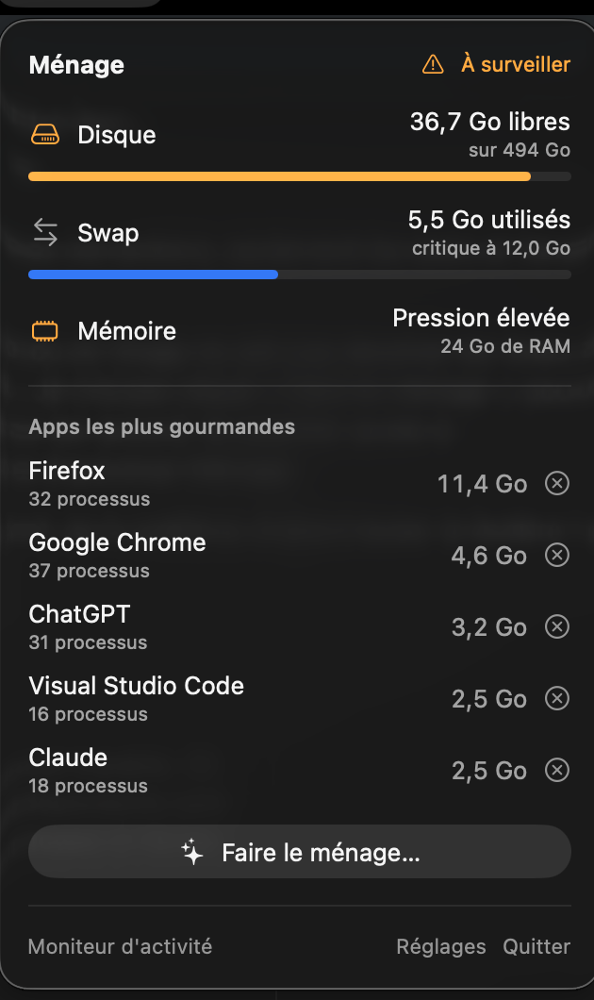
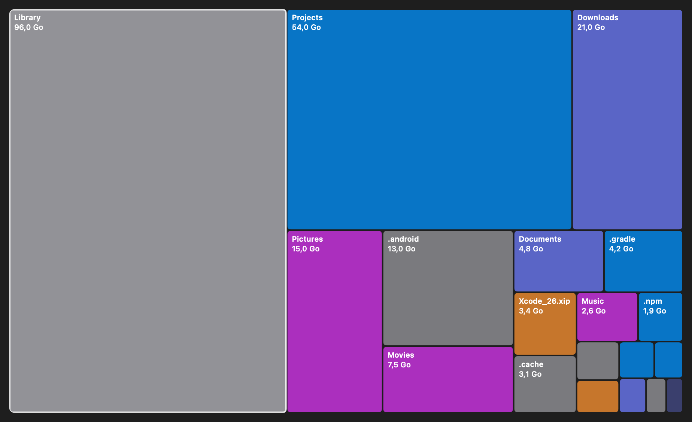
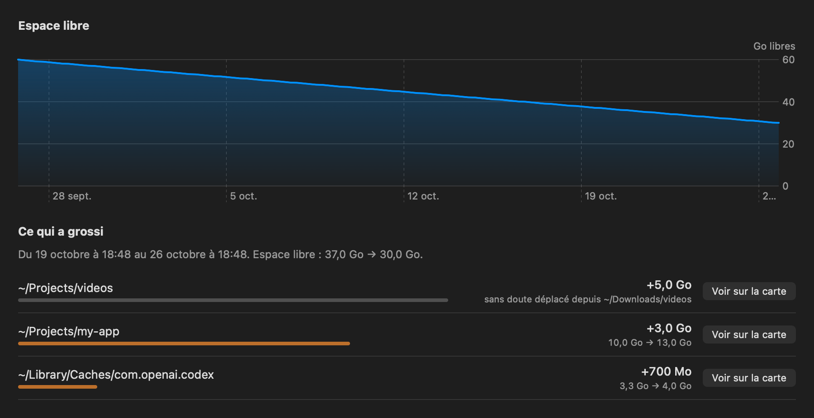

# Ménage

**A menu bar app that keeps a developer's Mac from running out of disk and memory, and cleans up
safely.**

*Ménage* is French for housekeeping. I built it after my Mac froze: swap was full (11.6 of 12 GB),
the disk was 93% full, and I had to hard-reset it. Ménage warns you before that happens, shows you
where the space went, and cleans up what a developer machine piles up (`node_modules`, Xcode
DerivedData, Android images, Docker caches…) without ever deleting anything for good.

> The interface is in **French** for now. English localization is the first contribution I'd welcome.

<p align="center">
  
</p>

## Features

**Menu bar and alerts**
- Free disk space always visible, plus swap and memory pressure, refreshed every 5 seconds.
- The 5 hungriest apps, with all their processes added up (Firefox's 30 helpers count as Firefox),
  and a button to quit one.
- Notifications when disk space, swap or memory pressure cross a threshold. Thresholds are
  adjustable; swap defaults to a quarter, then half, of your RAM.

**Cleaner**: 11 rules, each one explaining what it found and what removing it means.

| Rule | Risk |
|---|---|
| Xcode DerivedData, unavailable iOS simulators, app caches, installers of apps you already have | Safe, pre-checked |
| Build folders of **inactive** projects (`node_modules`, `.next`, `build`, `Pods`, `vendor`, `.dart_tool`, `target`…) | Regenerable |
| Unused Android system images, old NDK versions, emulator snapshots, Docker build cache and dangling images | Regenerable |
| Broken Android emulators, large files in Downloads | Check first |

Only *Safe* items are pre-checked. A project counts as inactive after 60 days without a commit or a
file change; the threshold is adjustable.

**Disk map**: your home folder as a squarified treemap, with a list, a breadcrumb and colors by
kind of content. About a minute for 2.4 million files, at most around 120 MB of memory.



**Large files**: every file over 100 MB, sortable, with an adjustable threshold.

**History**: free space over time, and *what grew* since the last scan, over 7 or 30 days. A daily
background scan feeds it, and you get a notification when a folder really grows by 5 GB or more.
Folders that were only renamed or moved are flagged as such, not as growth.



**Journal**: every cleanup is logged, with what went to the Trash, when, and how much it freed.

## Safety model

A cleaner is only useful if you can trust it. These rules are enforced in code and covered by tests.

1. **Nothing is deleted for good.** Everything goes to the Trash (`FileManager.trashItem`). The only
   exceptions are the Docker and `simctl` cleanups, which run the tool's own command; they are
   labelled *Commande* and shown before anything runs.
2. **You confirm the exact list.** A sheet shows every path and every command before acting.
3. **Protected paths**, checked when scanning and again right before trashing:
   - *sanctuaries*, never touched, nor anything inside them: `~/.ssh`, `~/.gnupg`, `~/Documents`,
     `~/Desktop`, `~/Pictures`, iCloud Drive, Mail, Messages, Keychains, `/System`, `/usr`…
   - *anchors*, whose content can be cleaned but never the folder itself: `~`, `~/Library`,
     `~/Downloads`, `/Applications`, your project roots…
   - Matching ignores case (APFS does) and resolves `..` and `/private`.
4. **Git decides what is a build artifact.** A folder containing a single tracked file is never
   proposed. Ambiguous names (`build`, `dist`, `vendor`, `venv`) must also be git-ignored; outside a
   git repository, they are left alone.
5. **Manual trashing from the map is stricter.** Inside `~/Library`, only `Caches`, `Developer`,
   `Android` and `Logs` can be trashed; app data (`Application Support`, `Containers`…) is refused.
6. **Everything is journaled** in `~/Library/Application Support/Menage/journal.jsonl`.

## Install

There is no prebuilt download yet: the app is not notarized. Build it from source.

Requirements: macOS 14 or later, and Xcode with Swift 6. It is built and tested with Xcode 26.2
(Swift 6.2); older toolchains are untested.

```bash
git clone https://github.com/agerxs/menage.git
cd menage
scripts/bundle.sh --install   # builds Menage.app, copies it to ~/Applications and launches it
```

`bundle.sh` signs the app with your *Developer ID Application* or *Apple Development* certificate
if you have one, and falls back to ad hoc signing otherwise. With a real certificate, macOS keeps
the app's permissions across updates; with ad hoc signing, it asks again after each rebuild.

**Permissions**
- *Notifications*: for the alerts.
- *Downloads, Documents, Desktop*: macOS asks the first time the map scans your home folder.
- *Full Disk Access* (optional): without it, about 140 system folders (Mail, Photos library…) can't
  be read and are counted as empty. The map says so and links to the right setting.

The app is not sandboxed, which is why it can't go on the Mac App Store: the sandbox would forbid
scanning your home folder and running `git`, `docker` or `xcrun`.

## Development

```bash
swift test            # 85 tests: rules, safety, scanner, treemap, history
swift build
```

The logic lives in `MenageCore`, a library with no UI and no dependencies, tested with Swift
Testing on real temporary folders and real git repositories. The SwiftUI app is in `Menage`.

Debug builds include tools that print or render, then quit. They never delete anything:

```bash
MENAGE_SCAN=1 .build/debug/Menage                        # run the cleaner's analysis in the terminal
MENAGE_MAP=~ .build/debug/Menage                         # scan a folder: duration, biggest items
MENAGE_TREEMAP=/tmp/map.png MENAGE_TREEMAP_DIR=demo .build/debug/Menage   # render the map
MENAGE_HISTORY=/tmp/history.png .build/debug/Menage      # render the history tab with demo data
MENAGE_RENDER=/tmp/panel.png .build/debug/Menage         # render the menu bar panel
```

Design notes, decisions and measurements are in [CONCEPTION.md](CONCEPTION.md) (in French).

## Known limitations

- French interface only.
- Scans your home folder, not the whole disk.
- APFS clones are counted at full size, like `du` does.
- Not notarized, so no direct download for now.

## Contributing

Issues and pull requests are welcome, English localization above all. Please run `swift test`
before opening a pull request. Any new cleanup rule must state its risk level and come with tests
proving it never proposes a protected path or a git-tracked file.

## License

[MIT](LICENSE) © 2026 Elvis AMANI
